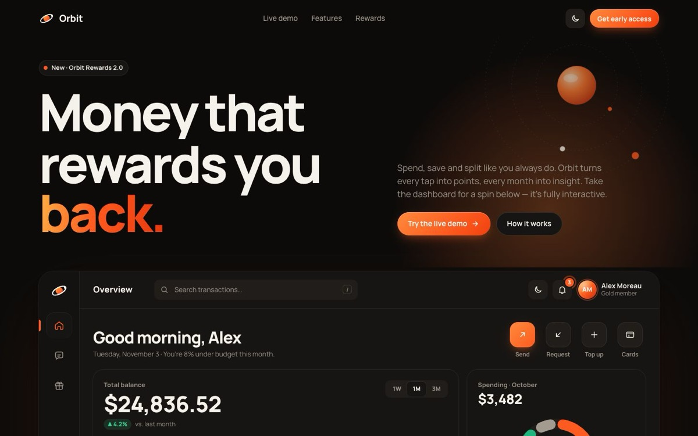

# Orbit — Rewards Dashboard

[](https://tabishhassan5121472.github.io/orbit-rewards-dashboard/)


A fintech landing page where the hero *is* the product: a live, interactive dashboard demo for "Orbit", a fictional money app that rewards you back.

**Live demo:** [https://tabishhassan5121472.github.io/orbit-rewards-dashboard/](https://tabishhassan5121472.github.io/orbit-rewards-dashboard/)

## Techniques
- App shell with a sliding "shared-layout" sidebar pill that becomes a bottom tab bar on mobile
- Animated view switching (leave / staggered enter) between Overview, Messages and Rewards
- Hand-built SVG area chart: draw-in stroke animation, crosshair + tooltip on hover, arrow-key inspection, range switcher
- Animated SVG donut segments, progress ring, count-up numbers, staggered transaction list with live search
- Chat thread with typing indicator and animated message bubbles
- Rewards card with shimmering sheen, 3D hover tilt offer cards, canvas confetti on redeem
- Light/dark theme via CSS custom properties and the View Transitions API (circular reveal, crossfade fallback)
- Respects `prefers-reduced-motion`, pauses offscreen animations, no build step, no images

Plain HTML, CSS and JavaScript — no dependencies.


## Run locally

```bash
npx serve .
```

## License

MIT — free to learn from and reuse.
